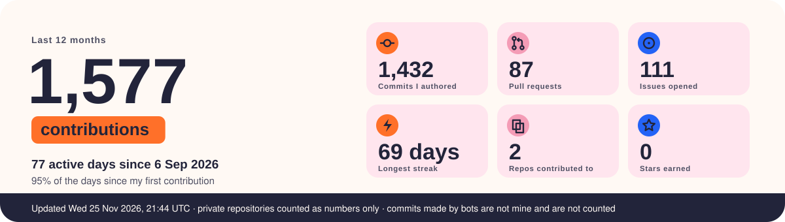
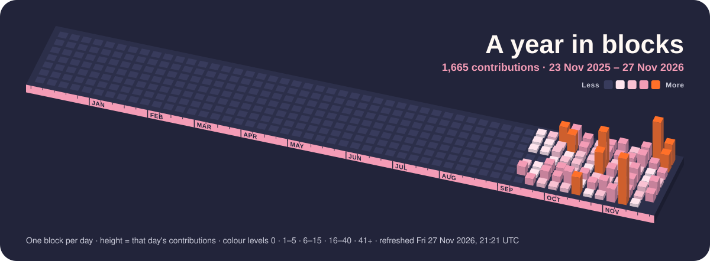
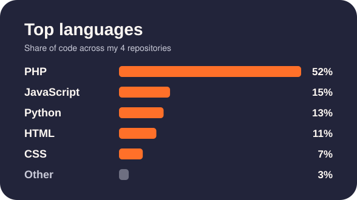
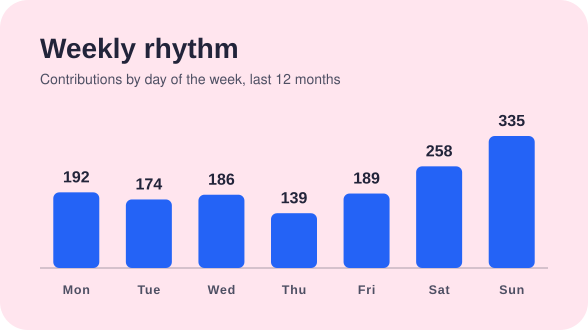
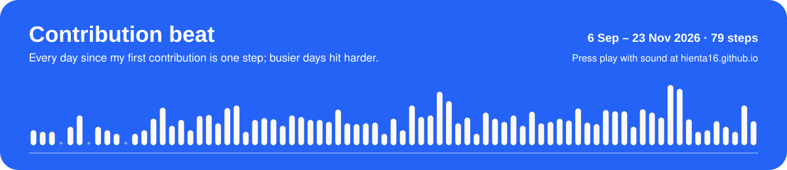
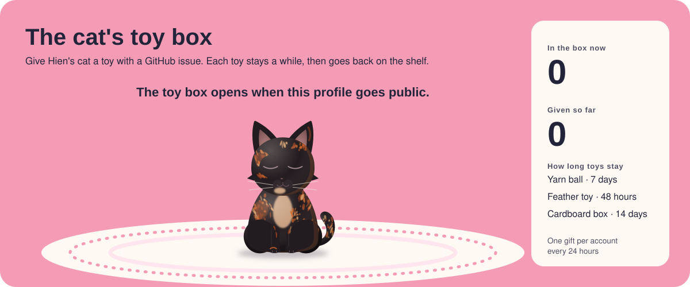

  

  
  &nbsp;
  

I'm a data analyst studying Information Systems at National Economics University (NEU) in Hanoi. I treat data the way I treat music and dance: find the rhythm first, then listen for the one note that doesn't belong. My tortoiseshell cat taught me the rest: watch the whole room before you pounce.

### By the numbers

  
  

<!-- catwalk:toys:start -->

The toy box opens when this profile goes public. Until then, the cat is practising alone.

How the toy box works

- Each button opens a GitHub issue with the title filled in, like `[cat-toy] yarn`. Press **Create**.
- A GitHub Action runs Python that reads three things GitHub vouches for: who opened the issue, when, and the toy named in the title. The issue text is never read or run.
- One gift per GitHub account every 24 hours. Toys stay a while: yarn ball 7 days, feather toy 48 hours, cardboard box 14 days.
- Up to 9 toys at once; when the box is full, the oldest goes back on the shelf. Every gift still counts in the total.
- The Action replies on your issue, closes it, and redraws the picture above. The code is in [`catwalk/toys/`](catwalk/toys).

<!-- catwalk:toys:end -->

### Backstage

Case studies, notebooks and dashboards are being prepared. They land here when they are ready to be public.

<!-- catwalk:updated:start -->
Numbers from the GitHub API, drawn by Python in [`catwalk/`](catwalk) · last refresh Sun 22 Nov 2026, 21:42 UTC, a snapshot; the automatic refresh switches on when this profile goes public. Private repositories are counted as numbers only; commits by bots are not counted.
<!-- catwalk:updated:end -->
